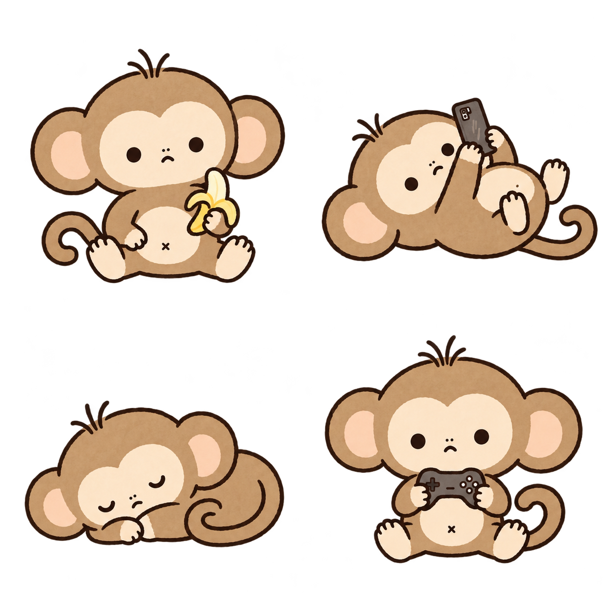

# 끼끼 🐒

화면 구석에서 먹고, 자고, 폰 보고, 게임하는 작은 원숭이.
내가 바쁜 동안 옆에서 느긋하게 쉬는 Windows·macOS 바탕화면 펫입니다.



**[Windows용 ZIP 다운로드](https://github.com/ajtwoddl-tjdud/kikki-desktop-pet/releases/latest/download/Kikki-Windows.zip)** · [릴리스 목록](https://github.com/ajtwoddl-tjdud/kikki-desktop-pet/releases)

## 2D / 3D 모습 바꾸기

끼끼를 우클릭하거나 Mac 메뉴 막대의 **🐒 → 끼끼 모습 · 2D / 3D**에서 **2D · 원래 끼끼** 또는 **3D · 말랑 끼끼**를 고릅니다. 활동과 진행 중인 동작은 유지되며 선택은 다음 실행에도 적용됩니다. 3D의 앉기·눕기 전환은 실제 중간 자세를 포함해 0.07초 단위로 재생하며, 다른 행동을 자동으로 고르는 간격은 기존과 같습니다. Windows도 같은 우클릭 메뉴를 사용합니다.

3D 모드는 Blender에서 렌더링한 투명 PNG 동작 이미지를 재생합니다. 실시간 3D 엔진이나 Blender 설치 없이 실행되며, 원래의 2D 이미지는 보존됩니다. 기존 122개 프레임, 자세 전환 13개, 걷기·폰 보기·하트·폰 줍기용 122개를 포함한 총 257개 프레임을 제공합니다. 3D 파일을 읽지 못하면 시작 시 2D로 돌아가며, 실행 중 전환 실패 시 기존 모습이 유지됩니다.

Mac의 **특별 동작** 메뉴에서도 셀카, 릴스 4종, 머리카락 하트, 매운 라면, 흡연, 심벌즈, 누운 스트레칭을 두 모습으로 재생할 수 있습니다. Mac의 특별 동작은 수동 재생이며 Windows의 전체 자동 동작·소리 정책과는 다릅니다.

3D 원본·재생성 방법은 [3D 애셋 안내](assets/3d/README.md)를 참고하세요.

## Mac에서 실행하기

**macOS 12 Monterey 이상, Apple Silicon·Intel Mac**용 네이티브 앱을 제공합니다. Windows PowerShell이나 별도 런타임은 필요하지 않습니다.

### 이 저장소에서 바로 실행

1. Xcode Command Line Tools가 없다면 터미널에서 `xcode-select --install`을 실행합니다.
2. 저장소의 **`Start-Mac.command`를 더블클릭**합니다. 또는 터미널에서 아래 명령을 실행합니다.
3. 현재 CPU용 개발 앱의 빌드와 자체 검사가 끝나면 끼끼가 화면 오른쪽 아래에 나타납니다. 실행 중인 이전 Kikki는 종료됩니다. 개발 앱은 `outputs/macos-dev/Kikki.app`에 생성됩니다.

```bash
bash macos/build.sh
open outputs/macos/Kikki.app
```

완성된 **`outputs/macos/Kikki.app`**을 응용 프로그램 폴더로 옮겨두고 더블클릭해도 됩니다. 빌드할 때만 개발 도구가 필요하며, 앱 안에 캐릭터 이미지가 포함됩니다. 앱을 다시 열면 실행 중인 끼끼를 보여줍니다.

### 빌드된 앱으로 실행

로컬 빌드 시 **`outputs/macos/Kikki-macOS.zip`**도 생성됩니다. 다른 Mac에 옮길 때는 ZIP을 풀고 **Kikki.app**을 응용 프로그램 폴더로 옮겨 실행하세요. 현재 Mac 빌드는 로컬 임시 서명만 하며, Apple Developer ID 서명·공증은 포함하지 않습니다. 인터넷에서 받은 앱을 macOS가 차단하면, 출처를 확인한 뒤 **시스템 설정 → 개인정보 보호 및 보안 → 확인 없이 열기**를 사용하세요. 회사·학교 관리 정책에 따라 허용되지 않을 수 있습니다. [Apple의 앱 실행 안내](https://support.apple.com/en-us/102445)를 참고하세요.

### Mac 조작

- **클릭·드래그·위로 들어올리기·우클릭**으로 반응과 메뉴를 사용할 수 있습니다. 트랙패드는 두 손가락 클릭으로 메뉴를 엽니다.
- **Control+M**으로 숨기거나 다시 보여줍니다. 별도 단축키 도우미가 필요 없습니다. 다른 앱과 충돌하면 메뉴 막대의 **🐒 → 끼끼 보이기/숨기기**를 사용하세요.
- 우클릭 또는 메뉴 막대의 **🐒**에서 활동 선택, 폰 떨어뜨리기·줍기, 자세 고치기, 등 돌리기, 표정, 산책, 움직임 줄이기, 크기와 종료를 선택합니다.
- 숨기면 움직임과 활동 시간이 멈춥니다.
- 현재 모니터의 메뉴 막대·Dock을 제외한 영역에서 산책하고, 모니터를 분리하면 보이는 화면으로 위치를 보정합니다.
- 자동 실행을 원하면 **시스템 설정 → 일반 → 로그인 항목**에 보관할 `Kikki.app`을 직접 추가하세요.
- 종료는 **🐒 → 끼끼 퇴근**, 삭제는 종료 후 앱을 휴지통으로 옮기면 됩니다. 로그인 항목에 추가했다면 함께 제거하세요. 킹받기 설정까지 지우려면 종료 후 터미널에서 `defaults delete io.github.ajtwoddl-tjdud.kikki mischiefLevel`을 실행합니다.

Mac판은 기존 이미지를 AppKit으로 재생합니다. Windows판과 세부 애니메이션·대사·전환 효과는 다를 수 있습니다. 전체 화면 앱·Stage Manager에서의 표시 방식은 macOS의 창 정책에 영향을 받습니다. Linux는 지원하지 않습니다.

## Windows 실행 환경

- Windows와 Windows PowerShell 5.1의 WPF 데스크톱 환경이 필요합니다.
- 별도 패키지 설치, 계정, API 키, 인터넷 연결 없이 실행합니다.
- 아래의 PowerShell 명령은 `pwsh` 대신 Windows의 `powershell.exe`를 사용합니다.
- Mac에서는 위의 macOS 앱을 사용하세요. 아래 VBS·PowerShell 안내는 Windows용입니다.

## 1. 다운로드하고 실행하기

1. 위의 **Windows용 ZIP 다운로드**를 누릅니다.
2. ZIP의 압축을 모두 풉니다. 예를 들어 `D:\Apps\Kikki`처럼 계속 보관할 폴더를 정하세요.
3. 압축을 푼 `Kikki` 폴더에서 **`Start.vbs`를 더블클릭**합니다.
4. 화면 오른쪽 아래에 끼끼가 나타납니다.

ZIP 안에서 바로 실행하지 말고 먼저 압축을 풀어주세요. `.ps1` 파일, `Runtime.cs`와 `assets` 폴더는 함께 있어야 합니다. `Doongi.ps1`은 끼끼의 실행 파일 이름입니다.

### VBS 실행이 안 되는 경우

압축을 푼 폴더를 열고 탐색기 주소창에 `powershell`을 입력한 뒤 Enter를 누릅니다. 열린 Windows PowerShell에서 실행하세요.

```powershell
powershell.exe -NoProfile -ExecutionPolicy Bypass -STA -File .\Doongi.ps1
```

이 명령은 별도의 실행 창이 열려 있을 수 있습니다. 평소에는 창을 숨겨 실행하는 `Start.vbs`를 쓰면 됩니다.

## 2. Ctrl+M 설정하기

1. 같은 폴더에서 **`Enable-Hotkey.vbs`를 더블클릭**합니다.
2. **Ctrl+M**을 누르면 끼끼가 실행됩니다.
3. 실행 중에 다시 누르면 숨겨지고, 한 번 더 누르면 다시 나타납니다.

이미 끼끼가 켜져 있다면 첫 Ctrl+M은 숨기기입니다. 숨기는 동안 위치와 뽀모도로 타이머는 유지되고, 움직임은 멈춥니다. 앱은 중복으로 실행되지 않습니다.

단축키 도우미는 작업 표시줄 **알림 영역**에 있습니다. 숨겨진 아이콘을 보려면 `^`를 누르세요. 아이콘을 우클릭하면 보이기·숨기기와 도우미 종료 메뉴가 나옵니다. 도우미가 켜져 있는 동안 Ctrl+M은 끼끼에 사용됩니다.

VBS 대신 아래 명령으로 도우미를 실행할 수도 있습니다.

```powershell
powershell.exe -NoProfile -ExecutionPolicy Bypass -STA -File .\Hotkey.ps1
```

## 3. 로그인할 때 단축키 도우미 자동 실행하기 — 선택 사항

ZIP을 풀었다고 자동 실행이 등록되지는 않습니다. 매번 `Enable-Hotkey.vbs`를 켜기 번거롭다면 아래처럼 설정하세요.

1. `Enable-Hotkey.vbs`를 우클릭해 **바로 가기 만들기**를 선택합니다. Windows에 따라 **더 많은 옵션 표시** 안에 있습니다.
2. **Win+R**을 누르고 `shell:startup`을 입력해 시작프로그램 폴더를 엽니다.
3. 만든 **바로가기**를 그 폴더로 옮깁니다. 이름은 `끼끼 Ctrl-M`처럼 정하면 됩니다.
4. 다음 로그인부터 단축키 도우미가 켜집니다. 끼끼는 **Ctrl+M을 눌러 불러오면** 됩니다.

`Enable-Hotkey.vbs` 원본만 시작프로그램 폴더로 옮기지 마세요. 원본은 앱 폴더에 두고 **바로가기만** 등록합니다. 앱 폴더를 옮겼다면 이전 바로가기를 지우고 새 위치에서 다시 만드세요.

## 끼끼랑 지내기

| 조작 | 반응 |
| --- | --- |
| 한 번 클릭 | 하던 일을 잠깐 멈추고 상황에 맞게 한마디 합니다. |
| 빠르게 여러 번 클릭 | 세 번째부터 메롱·고개 갸웃·눈 감고 도리도리 반응을 번갈아 합니다. 잠·산책·촬영 중에는 해당 행동에 맞는 반응을 유지합니다. |
| 걷는 중 클릭 | 서 있는 몸과 발 자세를 유지하고 고개만 돌아봅니다. 약 1초 뒤 바로 이어 걷습니다. |
| 드래그 | 원하는 위치로 옮깁니다. |
| 위로 잡아끌기 | 얼굴을 찡그리고 발을 번갈아 휘젓습니다. |
| 놓기 | 바닥에 내려앉아 잠깐 투덜댑니다. |
| 우클릭 | 행동 선택, 산책, 움직임 줄이기, 크기, 타이머, 종료 메뉴가 나옵니다. |
| Ctrl+M | 단축키 도우미가 실행 중이면 불러오기·숨기기·다시 보이기가 가능합니다. |

끼끼는 자동 생활에서 활동을 보통 **2~4분마다** 바꿉니다. 바나나·폰·낮잠·게임을 섞어서 고르고, 같은 활동을 연속으로 고르거나 방금 하던 활동으로 바로 돌아가는 일을 줄였습니다. 자는 중에 자동으로 산책을 나가지는 않습니다.

Windows에서 폰 보기·낮잠을 시작하면 보통 **25~55초 뒤 옆으로 돌아눕는 자세**를 시도하고, 한 번 편하게 누우면 **2분~3분 30초** 유지합니다. 다른 장면이 진행 중이면 끝날 때까지 기다립니다. 옆으로 쉬는 도중에는 자동으로 일어나거나 산책하지 않으며, 자세를 끝까지 유지할 수 있도록 현재 활동 시간을 필요할 때 늘립니다. 눕는 시간 자체를 줄이지 않고 옆으로 누운 모습을 더 자주 볼 수 있게 한 설정입니다. 직접 클릭·드래그·행동 선택으로는 중단할 수 있습니다. 야랄 모드의 3초 전환은 그대로입니다.

작은 동작도 **2~4분 간격**으로 자세 고치기·표정 바꾸기·폰 떨어뜨리고 줍기·등 돌리기 중 가능한 것을 번갈아 시도합니다. 자동 산책은 한 번 다녀온 뒤 **2~4분 쉬고 화면의 반대쪽 끝까지** 갑니다. 화면 중앙으로 옮겼다면 먼저 반대편 끝으로 가고, 그다음부터 양 끝을 오갑니다. 진행 중인 장면이나 클릭 반응이 끝나면 다음 행동을 시작하므로 실제 간격은 조금 늘어날 수 있습니다.

### 우클릭 메뉴에서 해볼 것

- **알아서 놀기**: 현재 활동을 유지하면서 자동 생활을 다시 켭니다.
- **바나나 먹기 / 폰 보기 / 낮잠 자기 / 게임하기**: 해당 활동을 직접 선택합니다. 다른 활동으로 자동 변경하는 기능은 꺼집니다. 작은 동작과 자동 산책은 별도 설정입니다.
- **폰 보다가 꾸벅…**: 폰을 떨어뜨리고 손으로 줍는 장면을 봅니다.
- **누워서 스트레칭**: 누운 상태로 팔·다리를 쭉 펴고 다시 웅크립니다. 4초가 안 되는 작은 동작 뒤에는 옆으로 누워 오래 쉽니다. 평소 낮잠 중에도 가끔 같은 동작을 합니다.
- **일어나다 다시 눕기**: 손으로 바닥을 짚고 반쯤 일어나다가 “아 몸 무거워.” 하고 다시 눕습니다. 약 5.5초 뒤 원래 옆으로 누운 자세로 돌아가 오래 쉽니다. 평소 낮잠 중에도 스트레칭과 둘 중 하나를 가끔 고르며, 활동이나 뽀모도로 시간을 초기화하지 않습니다. Windows에서 지원합니다.
- **불닭 먹기**: 면 들기 → 한 입 먹기 → 뒤늦게 매워하기 → 손으로 부채질 → 물 집어 들기 → 물 마시기로 이어집니다. 평소에는 약 10초 동안 먹고 원래 활동으로 돌아가며, 자동 생활 중에도 가끔 스스로 꺼내 먹습니다. 클릭하면 먹는 중·매워하는 중·물 마시는 중에 맞춰 대답합니다. 야랄 모드에서는 3초로 빠르게 이어지고, 움직임 줄이기에서는 면을 든 정지 자세로 보입니다. Windows에서 지원합니다. 이미지 제작에 사용한 프롬프트는 [`assets/kikki-spicy-noodles-prompt.md`](assets/kikki-spicy-noodles-prompt.md)에 있습니다.

Windows 자동 생활에서는 깨어 있는 모든 자세에서 셀카·릴스·담배·머리카락 하트·불닭을 고릅니다. 다섯 행동을 무작위로 섞어 한 번씩 보여준 뒤 다시 섞으므로 특정 행동만 계속 빠지지 않습니다. 긴 휴식과 진행 중인 동작은 끝까지 유지하고, 기다리던 새 행동은 다음 휴식이나 산책보다 먼저 시작합니다. 긴 옆누움 뒤에는 대기 시간을 한 번 더 붙이지 않습니다. 자동 생활을 껐거나 움직임 줄이기 중에는 자동으로 새 활동을 시작하지 않습니다. 업데이트 파일은 다음 실행부터 읽으므로, 켜져 있던 끼끼에는 종료 후 다시 실행해야 적용됩니다.
- **셀카 찍기 / 릴스 찍기**: 폰 들기·브이·윙크·사진 확인, 삼각대 옆에서 짧게 춤추는 장면을 봅니다. 릴스는 **팔 흔들기·어깨 까딱·발 스텝·손하트** 네 종류 중 매번 랜덤으로 고르고, 직전 종류는 연속으로 선택하지 않습니다. 각각 리듬과 마무리 포즈가 다르며 평소 자동 촬영과 야랄 모드 모두에 적용됩니다. 3초 뒤 원래 활동으로 돌아갑니다. 실제 카메라나 마이크를 켜거나 파일을 촬영하지 않는 캐릭터 연출입니다.
- **담배 뻑뻑 피우기**: 앉아서 담배를 입에 가져갔다가 내리고 연기를 후 내뿜는 짧은 만화 동작입니다. 평소에는 약 6.5초 뒤 원래 활동으로 돌아가고, 야랄 모드에서는 3초로 빠르게 재생합니다. 평소 자동 생활에서도 깨어서 쉬는 동안 가끔 셀카·릴스와 함께 랜덤으로 고릅니다. 클릭 대사는 현재 장면에 맞추며, 드래그하면 중단합니다. 움직임 줄이기에서는 정지 자세만 표시합니다. Windows에서 지원합니다.
- **머리카락으로 하트 만들기**: 머리 한 올 잡기 → 쏙 뽑고 움찔 → 양손으로 구부리기 → 갈색 머리카락 하트 내밀기 → 머리에 다시 꽂기의 여섯 동작입니다. 평소에는 약 5.6초, 야랄 모드에서는 3초 동안 재생하고 원래 활동으로 돌아갑니다. 평소 자동 생활에서도 가끔 고릅니다. 끝나거나 드래그로 중단해도 기본 머리 모양은 그대로이며, 뽀모도로 시간에는 영향을 주지 않습니다. 움직임 줄이기에서는 완성된 하트를 들고 있는 정지 자세를 보여줍니다. Windows에서 지원합니다.
- **야랄 모드 · 3초마다 난리 나기**: 아래 설명처럼 빠른 랜덤 행동을 켜거나 끕니다. Windows에서 지원합니다.
- **반대쪽 끝까지 산책 가봐**: 화면 반대쪽 끝까지 걷습니다.
- **자동 산책 켜기 / 끄기**: 산책 빈도 설정과 별개로 자동 산책을 켜거나 끕니다.
- **움직임 줄이기 / 다시 신나게**: 자동 동작과 자세 전환을 줄이거나 되돌립니다.
- **크기 바꾸기 · 작게 / 크게**: 기본 크기와 작은 크기를 전환합니다.

### 야랄 모드 (Windows)

끼끼를 우클릭하고 **야랄 모드 · 3초마다 난리 나기**를 선택하세요. 셀카·릴스 춤·담배·머리카락 하트·불닭 먹기·화면 횡단·바나나·폰 보기·폰 떨어뜨리고 줍기·눕기·게임 중에서 **3초마다 새 행동을 랜덤으로** 고릅니다. 정해진 순서는 없으며, 바로 전 행동의 연속 선택만 피합니다. 이동은 3초 동안 **대각선·지그재그로 꺾어서 걷거나 화면 옆으로 잠깐 나갔다 돌아오는 경로**를 랜덤으로 고릅니다. 모서리는 살짝 둥글게 돌고, 걸음은 실제 이동 거리에 맞춥니다. 끝나는 위치는 화면 안이며, 모드를 중간에 끄면 밖에 있던 끼끼도 화면 안으로 돌아옵니다. 걸을 때 클릭하면 잠깐 돌아본 뒤 남은 경로를 이어갑니다. 폰 떨어뜨리기는 줍는 과정까지, 눕기는 눕는 과정까지 빠르게 연결합니다. 평소 산책은 기존의 느긋한 가로 이동을 유지합니다.

메뉴를 다시 누르면 켜기 전의 활동·자동 생활·움직임·자동 산책 설정으로 돌아갑니다. 다른 행동이나 움직임 메뉴를 직접 골라도 야랄 모드를 끝냅니다. 뽀모도로와 크기 변경은 모드를 유지합니다. 끌고 있는 동안에는 다음 행동을 기다리며, Ctrl+M으로 숨기면 활동 시간도 멈춰서 다시 나타날 때 밀린 행동을 몰아 하지 않습니다. 앱을 다시 켜면 야랄 모드는 꺼진 상태입니다.

평소 자동 생활은 기존 속도를 유지합니다. 깨어서 폰을 볼 때는 드물게 셀카나 릴스 동작을 하고 돌아오기도 합니다. Mac판에는 이 모드와 새 촬영 동작이 아직 없습니다.

### 뽀모도로 — 내 시간으로 집중하기 (Windows)

1. 끼끼를 우클릭 → **뽀모도로 설정 · 시작**을 누릅니다.
2. **집중 시간**, **휴식 시간**, **집중 반복 횟수**를 정합니다. 기본값은 25분 / 5분 / 4회입니다.
3. **시작**을 누르면 집중 → 휴식 → 다음 집중으로 자동 전환합니다. 마지막 집중이 끝나면 세션을 마칩니다.

집중은 1~240분, 휴식은 1~120분, 반복은 1~12회까지 정수로 설정할 수 있습니다. 실행 중 설정 창에서 **새로 시작**을 누르면 이전 타이머 대신 새 설정으로 시작합니다.

타이머가 돌아갈 때 끼끼를 **한 번 클릭**하면 먼저 `집중해. 12분 남았어.` 또는 `좀 쉬어. 3분 남았어.`처럼 알려줍니다. 약 1.6초 뒤에는 하던 상황에 맞는 원래 대사를 합니다. 1분 이하일 때는 초 단위로 알려줍니다. 산책 중에는 1초만 서서 돌아보고, 타이머 안내와 후속 대사는 걷기를 다시 멈추지 않고 이어집니다.

- **뽀모도로 남은 시간**: 남은 시간만 확인합니다.
- **뽀모도로 일시정지 / 계속**: 남은 시간을 그대로 보관했다가 이어갑니다. 일시정지 중 클릭하면 멈춘 상태와 남은 시간을 알려줍니다.
- **뽀모도로 끝내기**: 현재 세션을 취소합니다.

집중 중 건드리면 시간 안내 뒤에 **“넌 빨리 공부해~”**, **“난 폰 봐도 돼. 넌 집중해~”**, **“나 한 판만 더. 넌 한 쪽만 더.”**처럼 상황에 맞춰 장난스럽게 공부를 재촉하기도 합니다. 휴식·일시정지 중에는 이 대사를 쓰지 않습니다. **킹받기 조절**의 순한맛에서는 덜 자주 나오고, 끄기에서는 나오지 않습니다.

집중·휴식이 바뀌면 말풍선으로 알려주고, Ctrl+M으로 숨긴 동안에도 타이머는 계속 갑니다. 숨겨진 동안의 알림은 다시 보일 때 가장 최근 상태만 표시합니다. 컴퓨터가 절전에서 돌아오면 지나간 시간을 반영합니다. 끼끼의 평소 생활이나 작은 동작의 빈도는 바꾸지 않습니다.

Windows에서는 **집중 종료·휴식 종료·마지막 집중 종료 때마다 심벌즈를 다섯 번 치는 약 3초짜리 동작과 소리**가 나옵니다. 알림 중에는 평소 행동 시간을 잠깐 멈추고, 끝나면 하던 일을 이어갑니다. 드래그 중이면 동작은 내려놓은 뒤 시작합니다. 숨겨져 있어도 종료 소리는 나며, 동작은 다시 표시할 때 한 번 보여줍니다. 절전 등으로 여러 구간이 지나갔어도 알림을 몰아서 재생하지 않습니다. 시작·일시정지·수동 취소에는 울리지 않습니다.

우클릭 → **심벌즈 쳐봐**로 바로 확인할 수 있습니다. **뽀모도로 심벌즈 소리**를 해제하면 동작만 보이고 소리는 나지 않습니다. 소리 설정은 이번 실행에 적용되며 다시 켜면 기본값인 켜기로 돌아갑니다. 소리는 로컬 WAV 파일로 재생하며, 새 이미지와 제작 프롬프트는 [`assets/kikki-extras-prompt.md`](assets/kikki-extras-prompt.md)에 기록했습니다. 이번 심벌즈·스트레칭 동작은 Windows에서 지원합니다.

수업 전용 메뉴는 제거하고 Windows의 시간 관리는 뽀모도로로 통합했습니다. 새 뽀모도로를 시작하면 기존 세션은 취소됩니다.

**v0.4.3부터 앱을 종료하거나 업데이트 후 다시 실행해도 진행 중인 뽀모도로와 입력한 설정이 유지됩니다.** 집중·휴식 단계, 반복 횟수, 종료 시각, 일시정지한 남은 시간을 `%APPDATA%\Kikki\pomodoro.json`에 저장합니다. 앱이 꺼진 동안에도 진행 중인 타이머는 실제 시각대로 흐르며, 다시 켜면 지난 구간을 반영합니다. 일시정지한 타이머는 계속 멈춰 있습니다. 이미 끝냈거나 수동 취소한 타이머는 다시 생기지 않습니다. 상태는 임시 파일에 쓴 뒤 교체해 저장하며, 바로 전 파일은 `.previous`로 남깁니다.

업데이트를 위해 실행 중인 앱을 강제로 끌 필요는 없습니다. 새 파일을 덮어쓰고, 현재 세션이 끝난 뒤 끼끼를 종료·재실행하면 됩니다. **v0.4.2 이전 실행에는 저장 기능이 없으므로, 첫 업데이트 때 진행 중인 타이머가 있다면 끝난 뒤 재실행하세요.**


### 킹받기 조절

대사는 먹기·폰·게임·수면, 산책 중 돌아보기, 등 돌리고 쉬기, 들어올리기·내려놓기, 폰 떨어뜨리기별로 나눕니다. “안녕하숭~”, “아 이것까지만 볼게”, “불렀으면 쓰다듬고 가…”처럼 짧고 상황에 맞는 말을 섞습니다. 말투는 짧고 툭 던지는 느낌으로 통일했습니다. 길게 설명하는 농담, 귀엽다고 스스로 강조하는 말, 억지 어미는 덜어내고 폰·산책의 원래 “처음 봐?” 대사는 남겼습니다. Windows에서는 최근에 말한 문장을 피해서 고릅니다. 집중 중 장난도 끼끼의 현재 활동과 집중을 막 시작했는지·곧 끝나는지에 맞춰 섞습니다. 대사가 늘어도 말하는 빈도나 움직임 간격은 늘리지 않습니다.

우클릭 또는 Mac 메뉴 막대 **🐒 → 킹받기 조절**에서 고릅니다. 두 플랫폼 모두 선택을 저장하며, 재실행해도 유지합니다.

| 설정 | 반응 |
| --- | --- |
| **기본** | 상황에 맞는 대사의 60% 확률로 밈을 섞습니다. 밈 사이에는 최소 30초를 쉬며, 클릭할 때 잠깐 얄미운 표정도 짓습니다. |
| **순한맛** | 확률을 20%로 낮추고 밈 사이에 최소 2분을 쉽니다. 추가 클릭 표정은 생략합니다. |
| **끄기** | 추가한 밈 대사와 클릭 표정을 끄고 평소 대사를 사용합니다. |

게임을 시작하거나 응원할 때는 **“티~원”, “요~~~이”**, 게임 한 판을 마칠 때는 **“줴줴이야~”**, 폰을 떨어뜨리면 **“못 본 척 해줘~~”** 같은 말풍선이 나옵니다. 같은 밈을 바로 반복하지 않습니다. 대사에는 음성이 없으며, 소리는 위의 뽀모도로 심벌즈 알림에만 사용합니다. 움직임 줄이기를 켜면 추가 클릭 표정도 생략합니다.

## 종료·업데이트·삭제

- **끼끼만 종료**: 끼끼를 우클릭 → **끼끼 퇴근**. 단축키 도우미가 켜져 있으면 Ctrl+M으로 다시 부를 수 있습니다.
- **단축키 도우미도 종료**: 알림 영역의 끼끼 아이콘을 우클릭 → 도우미 종료.
- **업데이트**: 둘 다 종료한 뒤 새 ZIP으로 앱 파일을 교체합니다. 폴더 위치가 바뀌면 자동 실행 바로가기도 다시 만듭니다.
- **삭제**: 둘 다 종료하고 `shell:startup`에 등록한 바로가기와 앱 폴더를 삭제합니다. 킹받기 설정까지 지우려면 `%APPDATA%\Kikki` 폴더도 삭제합니다. 설치 프로그램이나 시스템 서비스는 없습니다.

## 안 켜지거나 단축키가 안 될 때

| 증상 | 확인할 것 |
| --- | --- |
| 더블클릭해도 안 보임 | 먼저 Ctrl+M으로 숨겨진 상태인지 확인합니다. 알림 영역의 도우미가 없으면 `Start.vbs`로 실행해 보세요. |
| Ctrl+M이 안 됨 | `Enable-Hotkey.vbs`를 실행했는지 확인합니다. 다른 앱이 같은 전역 단축키를 쓰는지도 확인하세요. |
| VBS가 실행되지 않음 | 위에 적은 `powershell.exe` 명령으로 직접 실행합니다. |
| 다운로드한 파일 실행이 차단됨 | ZIP의 속성에 **차단 해제**가 있으면 해제하고 다시 압축을 풀어보세요. |
| 그림이 없거나 오류가 남 | ZIP을 전부 풀었는지, `assets` 폴더와 모든 `.ps1` 파일이 함께 있는지 확인합니다. |
| 실행 후 곧 사라짐 | Windows PowerShell에서 직접 실행하면 오류 내용을 볼 수 있습니다. 동일한 끼끼가 이미 실행 중이면 추가 실행은 종료됩니다. |
| 다른 모니터로 옮겼는데 돌아옴 | 현재 위치 보정과 산책 범위는 기본 모니터의 작업 영역을 기준으로 합니다. |

오류를 제보할 때는 Windows 버전, 실행한 파일, 오류 문구를 [Issues](https://github.com/ajtwoddl-tjdud/kikki-desktop-pet/issues)에 남겨주세요.

Mac 오류는 macOS 버전, Apple Silicon/Intel 여부와 실행·빌드 오류를 함께 남겨주세요.

## 개발·동작 확인

### macOS

```bash
bash macos/build.sh
# 이미 빌드한 앱의 검사만 다시 실행
outputs/macos/Kikki.app/Contents/MacOS/Kikki --self-test
```

빌드는 macOS 12를 배포 대상으로 `arm64`·`x86_64`를 각각 컴파일하고 하나의 Universal 앱으로 묶습니다. 이미지 로딩·렌더링, 숨김 중 활동 정지와 타이머 완료, 산책 일시 정지·재개·도착, 자세·폰 줍기·들어올리기 프레임을 검사합니다. Intel 바이너리 빌드 성공은 Intel 실기기 실행 검증과 구분해야 합니다. UI 수동 확인 항목은 [macos/README.md](macos/README.md)를 참고하세요.

### Windows

이벤트 전달·타이머 정책·활동 주기·대사 선택을 먼저 검사하려면 다음을 실행합니다. WPF 전체 검사는 그 아래의 `Doongi.ps1 -SelfTest`를 사용합니다.

```powershell
powershell.exe -NoProfile -ExecutionPolicy Bypass -File .\tests\Runtime.SelfTest.ps1
```

Windows PowerShell에서 저장소 폴더를 연 뒤 실행합니다.

```powershell
powershell.exe -NoProfile -ExecutionPolicy Bypass -STA -File .\Doongi.ps1 -SelfTest
```

이미지 로딩, 걷기·클릭·재개, 들어올리기, 자세 전환, 수면 유지, 말풍선 위치, 숨기기·다시 보이기, 뽀모도로의 설정 입력·집중/휴식 전환·일시정지·클릭 대사 순서를 검사합니다. 임시 검사 창은 화면 밖에서 열렸다가 닫힙니다.

| 파일 | 역할 |
| --- | --- |
| `macos/Sources/` | macOS AppKit 앱, 활동 상태, 이미지 시트와 자체 검사 |
| `macos/build.sh`, `Start-Mac.command` | Universal Mac 앱·ZIP 빌드와 실행 |
| `Runtime.ps1`, `Runtime.cs` | Windows 갱신 주기·수업 종료 예약·이벤트 기반 숨김/복귀 |
| `Doongi.ps1` | WPF 창, 대사, 입력, 메뉴, 타이머 |
| `Mischief.ps1`, `assets/mischief.json` | 상황별 밈 대사, 빈도 조절과 설정 저장 |
| `Behavior.ps1` | 활동 유지 시간과 활동 전환 |
| `Roaming.ps1` | 산책과 서서 돌아보기 |
| `Resting.ps1` | 같은 활동 안에서의 작은 자세·표정 변화 |
| `Transitions.ps1` | 앉기·눕기·수면 사이의 전환 |
| `Lifting.ps1`, `Pickup.ps1`, `BackTurn.ps1` | 들어올리기, 폰 줍기, 등 돌리고 쉬기 |
| `Hotkey.ps1` | Ctrl+M 전역 단축키 도우미 |
| `Pomodoro.ps1` | 집중·휴식 설정 창, 타이머, 클릭 시 남은 시간 안내 |
| `Pomodoro.Tests.ps1` | 뽀모도로 상태 전환과 클릭 대사 순서 검사 |
| `PomodoroStore.ps1`, `PomodoroStore.Tests.ps1` | 타이머·설정 저장, 재시작 복구·일시정지·만료 검사 |
| `Routes.ps1` | 야랄 모드의 둥근 꺾임·지그재그·화면 밖 왕복 경로 |
| `Chaos.ps1`, `Chaos.Tests.ps1` | 3초 랜덤 모드, 셀카·릴스, 연속 클릭 반응과 복귀·중단 검사 |
| `Reels.ps1`, `Reels.Tests.ps1` | 릴스 네 종류, 랜덤 선택·리듬·자세·복귀 검사 |
| `Smoking.ps1`, `Smoking.Tests.ps1` | 흡연 동작 시트, 올리기·내뿜기·내리기와 복귀·중단 검사 |
| `HairHeart.ps1`, `HairHeart.Tests.ps1` | 머리카락 뽑기·하트 만들기·되돌리기와 타이머 보존 검사 |
| `Extras.ps1`, `Extras.Tests.ps1` | 종료 심벌즈·소리, 누운 채 스트레칭과 중단·복귀 검사 |
| `Start.vbs`, `Enable-Hotkey.vbs` | 창을 숨겨 실행하는 런처 |
| `assets/` | 캐릭터의 투명 PNG 동작 시트와 공통 대사 데이터 |

이미지는 AI 이미지 생성 도구로 제작했습니다. 표정·동작 시트를 WPF에서 재생하는 2D 펫이며, 실제 게임이나 영상을 실행하거나 대화형 AI 서비스에 연결하지 않습니다. 3D 모드의 이미지는 Blender 모델에서 렌더링합니다.

타이머·렌더링 최적화와 측정 범위는 [OPTIMIZATION.md](OPTIMIZATION.md)에 정리했습니다.

3D 걷기는 32프레임(고개 돌린 걷기도 32), 폰 보기는 24프레임 순환, 하트 만들기는 21프레임, 폰 줍기는 13프레임입니다. 기존 이동 거리·시간과 자동 활동 간격을 유지합니다.
